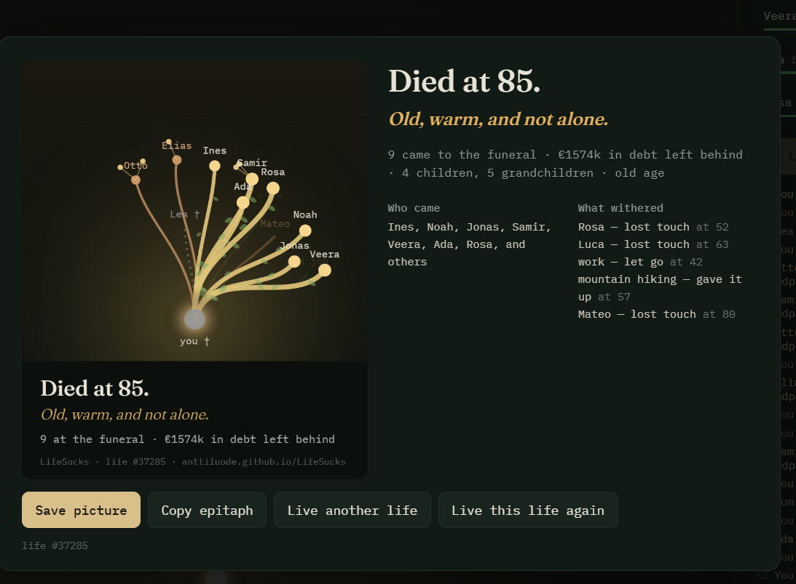

# LifeSucks



**Love is a flux. Stop feeding it and it stops.**

**Play:** https://anttiluode.github.io/LifeSucks/

You get a life from 18 to whenever it ends. Every year you have a few drops of attention, about twelve while you are young and fewer as you age. You pour them into the people in your life, into work, into yourself, into a dream.

Whatever you stop feeding withers **by itself**. There is no "divorce" button. Nothing in the code decides that your son stops calling. The flow through that branch just stops, the branch thins, and one year it is dry wood. Money comes from work, and warmth comes from people. Money cannot buy warmth.

At the end you get an epitaph, the list of who came to the funeral, what withered and when, and a picture of the vine your life became. You can save the picture or copy the epitaph with a link. The link opens the same life (`?seed=`), so friends can try to live it better.

## How it works

The game runs on the same rule as [Elävä Matriisi](https://github.com/anttiluode/ElavaMatriisiClaude), the vine economy that grew out of a real vine climbing a Texas sign:

```
Q      = your drops + what they give back by themselves (recip · D)
target = Dmax · Q / (Q + Qh)
dD     = η / (1 + D/Dwood)² · (target − D)      ← old, thick bonds change slowly
```

- **Every relationship is a channel with a conductance `D`.** Parents give back a lot on their own, so they never fully close. A partner gives back about half, so a partner needs you. Small children give back a lot; grown children much less. Work gives back nothing; it pays.
- **Slow wood.** A twenty-year friendship survives years of neglect. A friendship that is six months old does not. An old friend you lost can write to you years later, and the bond you get back depends on how deep it once was.
- **Warmth** comes in through open channels and is spent every year just by living. **Health** falls with age, with overwork, and when warmth runs low (loneliness is a health risk). **Money** grows with work, partly disappears into lifestyle, and costs you when children are small.
- **Events are forks, not verdicts:** meeting someone, a child, a promotion, a job in another city, a layoff, a sick parent, a teenager in trouble, a house, a dream, an old friend, the 4 a.m. "is this it?". Each one only adds or removes a channel or nudges a number. Everything after that still comes from the flux.
- **Retirement:** the work light goes out at 66 whether you are ready or not.

The model is `life.js` (pure, no drawing, runs in node too). The drawing and controls are in `game.js`.

## Simulated players

`node sim/bots.js 300` plays 300 lives per strategy. This is how the numbers were balanced; nothing is fitted to any real data.

| strategy | age at death p10 / median / p90 | money left (median, k€) | at the funeral (median) | years lonely (median) |
|---|---|---|---|---|
| workaholic (8 drops to work, 1 to partner) | 47 / 61 / 92 | 1,400 | 7 | 23 |
| family (partner, kids, parents first) | 65 / 75 / 85 | 3 | 12 | 0 |
| balanced (a little to everything) | 81 / 93 / 99 | 1,300 | 16 | 0 |
| loner with a dream | 65 / 76 / 87 | 2,200 | 3 | 26 |
| pure loner (work and self only) | 62 / 70 / 72 | 1,200 | 2 | 41 |
| social (many friends, thinly) | 77 / 89 / 95 | 1,400 | 4 | 0 |

The workaholic dies rich and early more often than anyone. The family life is warm, crowded and broke. Spreading attention thinly across many friends gives a long life and a small funeral. A balanced life currently does best, perhaps too clearly. Making it harder to "solve" is the first thing I'd tune with real players.

## Honest notes

- **No AI generates anything yet.** Names, events and epitaphs are written templates with randomness. A generative layer (a narrator that writes your year, images of the rooms going warm or cold) would sit naturally on top of the model, and the model already exposes everything it would need.
- **This is a game about real things.** Loneliness, estrangement and loss are in it on purpose, and some players will feel them. It doesn't mock anyone: a solitary life with a dream is a real, warm path, and nothing in it is a moral score. But it is not gentle.
- Balance comes from simulated players only, and real players will find what the bots didn't.

## Files

- `index.html`, `style.css`, `game.js` — the page
- `life.js` — the life model (also `require`-able in node)
- `sim/bots.js` — simulated players for balancing
- `.github/workflows/static.yml` — GitHub Pages deploy on push to `main`
